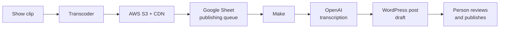

# AI media publishing pipeline

Turns clips from a daily live financial show into website posts with AI transcription, with a person reviewing every post before it goes live.

**Status:** in production, running after each show.

## Flow

1. **Clip** — segments from the show are exported after it airs.
2. **Transcode and host** — clips are transcoded and stored on AWS S3 behind a CDN.
3. **Queue** — each clip becomes a row in a Google Sheet that acts as the publishing queue.
4. **Make** — picks up queued clips and sends them to OpenAI for transcription.
5. **WordPress** — Make creates the post on the organization's WordPress site with the video and the AI-generated text.
6. **Human review** — a person reviews and publishes. The AI never publishes on its own.

## Why it's built this way

- **A spreadsheet as the queue.** The team already works in Google Sheets, so the queue is visible and editable without a custom interface.
- **Storage separate from publishing.** Video lives on S3/CDN, not in WordPress, which keeps the site light and the media fast.
- **Human in the loop.** The AI step drafts; a person decides what goes live under the organization's name.

## Stack

Make · OpenAI API · AWS S3 + CDN · Google Sheets · WordPress

## Not in this repo

The Make scenario, bucket names, API keys, prompts, and site code.
